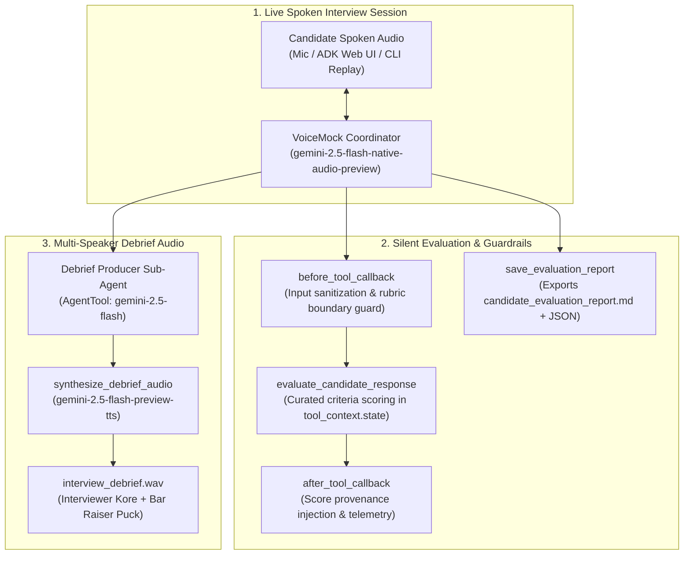

# VoiceMock: Live Interactive Technical Interviewer & Coach

VoiceMock is an autonomous, real-time spoken technical interviewer and coaching agent built with Google ADK (Agent Development Kit) and Gemini Live API models. It conducts realistic, interactive mock interviews (covering System Design and Architecture), asks clarifying follow-ups, silently scores candidate performance in the background against industry rubrics, and generates an executive debrief package: a structured Markdown scorecard, a machine-readable JSON evaluation, and a synthesized two-speaker post-interview audio debrief between the interviewer and a hiring manager.

## Architecture

VoiceMock implements a hierarchical coordinator-specialist agent architecture:



## Core Course Concepts Applied

1. **Native Audio Bidirectional Streaming**: Powered by `gemini-2.5-flash-native-audio-preview-09-2025` for natural, low-latency conversational cadence without separate STT $\rightarrow$ LLM $\rightarrow$ TTS lag.
2. **Coordinator-Dispatcher / Silent Background Worker**: The interviewer engages naturally via spoken dialogue while running silent rubric evaluations in the background, speaking only concise status updates to prevent candidate distraction.
3. **Programmatic Lifecycle Interceptors**:
   - `before_tool_callback`: Validates scoring criteria boundaries (clamping 1–5), sanitizes inputs, and prevents hallucinations.
   - `after_tool_callback`: Updates `tool_context.state['rubric_audit_trail']` and tracks cumulative stage progression.
4. **Typed Schema Data Contracts**: Pydantic v2 schemas (`RubricScore`, `CandidateEvaluation`, `DebriefScript`) ensuring deterministic data exchange between interview stages.
5. **Multi-Speaker Speech Synthesis**: Google GenAI SDK with `gemini-2.5-flash-preview-tts` and `MultiSpeakerVoiceConfig`, pairing two distinct voice personas (`Kore` as Lead Interviewer, `Puck` as Engineering Bar Raiser) in a 24 kHz 16-bit mono PCM WAV podcast.

## Project Structure

```text
voice-interview-coach/
├── agents/
│   ├── interview_agent.py        # Root coordinator running live interview and assessment
│   └── debrief_agent.py          # Specialist sub-agent generating dual-speaker audio recap
├── tools/
│   ├── rubric_tools.py           # Custom evaluation and scoring functions against rubric bank
│   ├── callbacks.py              # ADK before/after tool interceptors for state & provenance
│   ├── report_tools.py           # Markdown scorecard and JSON artifact persistence
│   └── audio_tools.py            # 24 kHz WAV audio synthesis using Gemini TTS
├── bank/
│   └── interview_questions.json     # Curated system design scenarios (Rate Limiter, TinyURL, Notification)
├── tests/
│   ├── test_schemas.py           # Pydantic contract validation tests
│   ├── test_tools.py             # Unit tests for scoring calculations, callbacks, and audio
│   └── test_pipeline.py          # End-to-end simulated and live Gemini API pipeline tests
├── agent.py                      # Standard Google ADK Web entrypoint
├── cli.py                        # Headless CLI entrypoint (mock, live-eval, interactive)
├── schemas.py                    # Pydantic models for scores, sessions, and debrief transcripts
├── requirements.txt              # Project dependencies
├── candidate_evaluation_report.md # Generated evaluation report artifact
├── evaluation_scorecard.json     # Generated machine-readable scorecard artifact
├── interview_debrief.wav         # Synthesized 24 kHz dual-speaker debrief audio
└── README.md                     # Project documentation
```

## How to Run

### 1. Prerequisites & Environment
Ensure `GEMINI_API_KEY` is configured in your workspace environment or in `.env`:
```bash
GEMINI_API_KEY="your-gemini-api-key"
```

### 2. Run Deterministic Mock Simulation
Simulates candidate answers across all 4 interview phases without consuming API quotas:
```bash
python cli.py --mode mock --scenario rate-limiter
```

### 3. Run Live Gemini API Assessment & Multi-Speaker Audio Synthesis
Executes real LLM evaluation using `gemini-2.5-flash` and synthesizes 2-speaker audio using `gemini-2.5-flash-preview-tts`:
```bash
python cli.py --mode live-eval --scenario rate-limiter
```

### 4. Run Live Spoken Audio via Google ADK Web UI
Launch the interactive web microphone interface:
```bash
adk web
```
Select `voice_interview_coordinator` from the dropdown to speak directly to the interviewer.

### 5. Run Automated Test Suite
Run all 12 unit, integration, and live Gemini API pipeline tests:
```bash
python -m pytest tests/ -v
```

## Generated Deliverables

- **Live Spoken Audio Session**: Interactive interview experience via ADK Web UI (`adk web`) or interactive CLI.
- **Candidate Evaluation Report**: [`candidate_evaluation_report.md`](file:///c:/Users/admin/Downloads/Coursera/Deeplearning.ai/Building%20Live%20Voice%20Agents%20with%20Google’s%20ADK/Projects/voice-interview-coach/candidate_evaluation_report.md) with 10-dimension rubric breakdown, qualitative critique, and hiring recommendation.
- **Evaluation Scorecard Data**: [`evaluation_scorecard.json`](file:///c:/Users/admin/Downloads/Coursera/Deeplearning.ai/Building%20Live%20Voice%20Agents%20with%20Google’s%20ADK/Projects/voice-interview-coach/evaluation_scorecard.json) typed machine payload for tracking.
- **Debrief Audio Podcast**: [`interview_debrief.wav`](file:///c:/Users/admin/Downloads/Coursera/Deeplearning.ai/Building%20Live%20Voice%20Agents%20with%20Google’s%20ADK/Projects/voice-interview-coach/interview_debrief.wav) 24 kHz 16-bit mono WAV featuring `Kore` (Lead Interviewer) and `Puck` (Bar Raiser).
