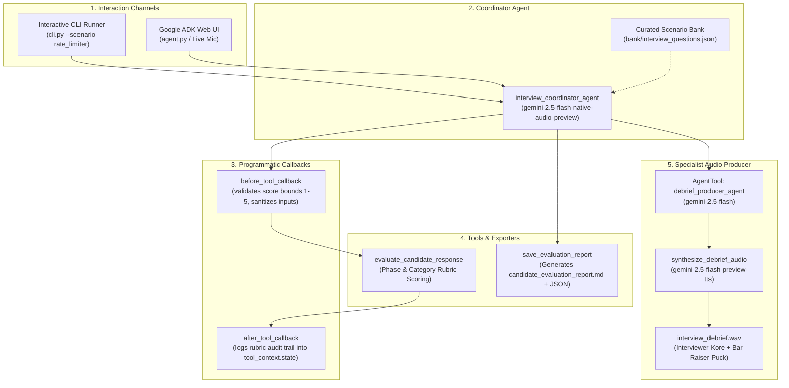

# Implementation Plan: VoiceMock (Live Interactive Technical Interviewer & Coach)

**Project**: VoiceMock (`voice-interview-coach`)  
**Scope**: Strictly inside `Projects/voice-interview-coach/`  
**Grill Log**: [grill-decisions.md](file:///c:/Users/admin/Downloads/Coursera/Deeplearning.ai/Building%20Live%20Voice%20Agents%20with%20Google’s%20ADK/Projects/voice-interview-coach/grill-decisions.md)

---

## 1. Goal

Build **VoiceMock**, an interactive spoken technical interviewer and coaching agent for System Design and Architecture interviews. Built on Google ADK and Gemini Live API models, it conducts a multi-phase system design interview, silently scores candidate performance against structured rubrics in `tool_context.state`, outputs formatted markdown and JSON scorecards, and synthesizes a dual-speaker post-interview audio debrief featuring a Lead Interviewer (`Kore`) and Bar Raiser (`Puck`).

---

## 2. Key Decisions (from Grill Log)

- **Interaction Model**: Hybrid runner — interactive CLI simulator + Google ADK Web live voice entrypoint.
- **Track**: System Design & Architecture (URL shortener, distributed rate limiter, notification service).
- **Evaluation Timing**: Continuous multi-stage evaluation across interview milestones (Requirements, High-Level Architecture, Deep Dive, Bottlenecks) logged in `tool_context.state`.
- **Programmatic Interceptors**: `before_tool_callback` for input score validation (1–5 scale) and `after_tool_callback` for audit telemetry.
- **Audio Synthesis**: `gemini-2.5-flash-preview-tts` with `MultiSpeakerVoiceConfig` generating 24 kHz 16-bit mono PCM WAV (`interview_debrief.wav`), with offline synthetic chime fallback.
- **Artifacts**: `candidate_evaluation_report.md` (physician-style scorecard), `evaluation_scorecard.json` (machine payload), and `interview_debrief.wav`.

---

## 3. Architecture & Data Flow

---

## 4. Proposed Changes

All files are created exclusively inside [Projects/voice-interview-coach/](file:///c:/Users/admin/Downloads/Coursera/Deeplearning.ai/Building%20Live%20Voice%20Agents%20with%20Google’s%20ADK/Projects/voice-interview-coach/):

### Milestone 1: Environment, Schemas & Scenario Bank

- `[NEW]` [requirements.txt](file:///c:/Users/admin/Downloads/Coursera/Deeplearning.ai/Building%20Live%20Voice%20Agents%20with%20Google’s%20ADK/Projects/voice-interview-coach/requirements.txt): Dependencies (`google-adk`, `google-genai`, `pydantic>=2.0`, `python-dotenv`, `pytest`).
- `[NEW]` [schemas.py](file:///c:/Users/admin/Downloads/Coursera/Deeplearning.ai/Building%20Live%20Voice%20Agents%20with%20Google’s%20ADK/Projects/voice-interview-coach/schemas.py): Pydantic contracts:
  - `InterviewPhase`: Enum (`requirements`, `high_level_design`, `deep_dive`, `bottlenecks_tradeoffs`)
  - `RubricCategory`: Enum (`architecture`, `scalability`, `data_modeling`, `communication`, `edge_cases`)
  - `RubricScore`: Model validating category, score (1–5), justification, and strengths/weaknesses
  - `SystemDesignScenario`: Model defining problem statement, constraints, expected architectural components, and sample questions
  - `CandidateEvaluation`: Comprehensive scorecard model aggregating phase scores, final hire recommendation, and summary
  - `DebriefDialogueTurn`: Speaker (`Interviewer` / `Bar Raiser`) and speech content
- `[NEW]` [bank/interview_questions.json](file:///c:/Users/admin/Downloads/Coursera/Deeplearning.ai/Building%20Live%20Voice%20Agents%20with%20Google’s%20ADK/Projects/voice-interview-coach/bank/interview_questions.json): Curated standard system design problems with structured rubrics and phase guidance (URL Shortener, Distributed Rate Limiter, Live Notification System).
- `[NEW]` [tests/test_schemas.py](file:///c:/Users/admin/Downloads/Coursera/Deeplearning.ai/Building%20Live%20Voice%20Agents%20with%20Google’s%20ADK/Projects/voice-interview-coach/tests/test_schemas.py): Automated tests validating Pydantic models and question bank consistency.

### Milestone 2: Evaluation Tools, Callbacks & Artifact Exporters

- `[NEW]` [tools/rubric_tools.py](file:///c:/Users/admin/Downloads/Coursera/Deeplearning.ai/Building%20Live%20Voice%20Agents%20with%20Google’s%20ADK/Projects/voice-interview-coach/tools/rubric_tools.py):
  - `load_scenario(scenario_id: str)`: Loads scenario data and rubrics from bank
  - `evaluate_candidate_response(...)`: Computes and records rubric scores
- `[NEW]` [tools/callbacks.py](file:///c:/Users/admin/Downloads/Coursera/Deeplearning.ai/Building%20Live%20Voice%20Agents%20with%20Google’s%20ADK/Projects/voice-interview-coach/tools/callbacks.py):
  - `validate_rubric_score_callback`: `before_tool_callback` clamping scores to 1–5 and scrubbing disallowed characters
  - `inject_rubric_audit_callback`: `after_tool_callback` logging timestamped rubric entries into `tool_context.state['rubric_audit_trail']`
- `[NEW]` [tools/report_tools.py](file:///c:/Users/admin/Downloads/Coursera/Deeplearning.ai/Building%20Live%20Voice%20Agents%20with%20Google’s%20ADK/Projects/voice-interview-coach/tools/report_tools.py):
  - `save_candidate_evaluation_report(...)`: Generates `candidate_evaluation_report.md` and `evaluation_scorecard.json`
- `[NEW]` [tools/audio_tools.py](file:///c:/Users/admin/Downloads/Coursera/Deeplearning.ai/Building%20Live%20Voice%20Agents%20with%20Google’s%20ADK/Projects/voice-interview-coach/tools/audio_tools.py):
  - `write_wave_file(...)`: Standard 24 kHz 16-bit mono PCM WAV writer
  - `synthesize_debrief_audio(...)`: Uses `gemini-2.5-flash-preview-tts` with `MultiSpeakerVoiceConfig` (`Kore` + `Puck`), with offline fallback
- `[NEW]` [tests/test_tools.py](file:///c:/Users/admin/Downloads/Coursera/Deeplearning.ai/Building%20Live%20Voice%20Agents%20with%20Google’s%20ADK/Projects/voice-interview-coach/tests/test_tools.py): Unit tests for evaluation scoring, callbacks, report formatting, and audio fallback.

### Milestone 3: Multi-Agent Orchestration (Coordinator & Specialist)

- `[NEW]` [agents/debrief_agent.py](file:///c:/Users/admin/Downloads/Coursera/Deeplearning.ai/Building%20Live%20Voice%20Agents%20with%20Google’s%20ADK/Projects/voice-interview-coach/agents/debrief_agent.py): Specialist sub-agent that drafts an 8–10 turn debate script between Kore and Puck, invoking `synthesize_debrief_audio`.
- `[NEW]` [agents/interview_agent.py](file:///c:/Users/admin/Downloads/Coursera/Deeplearning.ai/Building%20Live%20Voice%20Agents%20with%20Google’s%20ADK/Projects/voice-interview-coach/agents/interview_agent.py): Root coordinator running `gemini-2.5-flash-native-audio-preview` with two-message voice protocol (spoken acknowledgment $\rightarrow$ silent background scoring $\rightarrow$ concise wrap-up) and delegating to `AgentTool(debrief_agent)`.
- `[NEW]` [agent.py](file:///c:/Users/admin/Downloads/Coursera/Deeplearning.ai/Building%20Live%20Voice%20Agents%20with%20Google’s%20ADK/Projects/voice-interview-coach/agent.py): Standard Google ADK Web entrypoint exposing the coordinator agent.

### Milestone 4: Interactive CLI Runner, E2E Testing & Package Setup

- `[NEW]` [cli.py](file:///c:/Users/admin/Downloads/Coursera/Deeplearning.ai/Building%20Live%20Voice%20Agents%20with%20Google’s%20ADK/Projects/voice-interview-coach/cli.py): Dual-mode CLI runner:
  - `--mode mock`: Runs a deterministic automated simulation of a complete candidate interview
  - `--mode interactive`: Conducts a live turn-by-turn terminal/spoken session with the user
- `[NEW]` [tests/test_pipeline.py](file:///c:/Users/admin/Downloads/Coursera/Deeplearning.ai/Building%20Live%20Voice%20Agents%20with%20Google’s%20ADK/Projects/voice-interview-coach/tests/test_pipeline.py): End-to-end integration test verifying interview flow, rubric auditing, markdown/JSON export, and WAV synthesis.
- `[NEW]` [.env.example](file:///c:/Users/admin/Downloads/Coursera/Deeplearning.ai/Building%20Live%20Voice%20Agents%20with%20Google’s%20ADK/Projects/voice-interview-coach/.env.example) and [.gitignore](file:///c:/Users/admin/Downloads/Coursera/Deeplearning.ai/Building%20Live%20Voice%20Agents%20with%20Google’s%20ADK/Projects/voice-interview-coach/.gitignore).

---

## 5. Verification Plan

### Automated Tests
1. **Schema Validation**: `pytest Projects/voice-interview-coach/tests/test_schemas.py`
   - Validates question bank JSON against Pydantic schema
   - Asserts score bounds enforcement (1–5) and category enum parsing
2. **Tool & Callback Unit Tests**: `pytest Projects/voice-interview-coach/tests/test_tools.py`
   - Tests `before_tool_callback` score clamping
   - Tests `after_tool_callback` state provenance injection
   - Tests `save_candidate_evaluation_report` file creation (MD + JSON)
   - Tests `synthesize_debrief_audio` fallback and WAV header integrity
3. **End-to-End Pipeline Integration**: `pytest Projects/voice-interview-coach/tests/test_pipeline.py`
   - Runs simulated interview flow
   - Verifies generation of `candidate_evaluation_report.md`, `evaluation_scorecard.json`, and `interview_debrief.wav`

### Manual Verification
- Execute `python Projects/voice-interview-coach/cli.py --mode mock --scenario rate_limiter`
- Verify audio playback of `interview_debrief.wav` (duration, sample rate, clarity)
- Inspect generated `candidate_evaluation_report.md` for proper rubric breakdown and feedback structure
